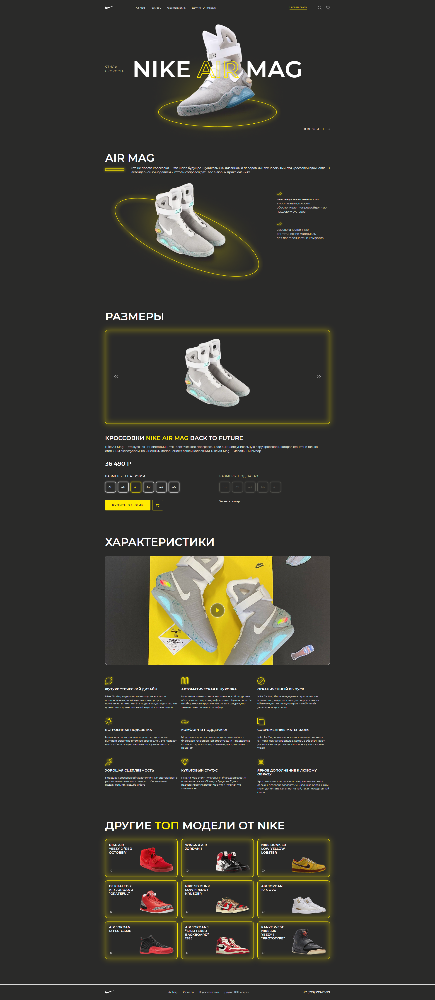

# Nike Air Mag — Landing Page

Product landing page for the limited-edition **Nike Air Mag "Back to the Future"** sneaker.

🔗 **Live demo:** https://programerit12.github.io/homework/Lesson20/index.html

## Tech stack
HTML · CSS · JavaScript

## Features
- Fully responsive layout (desktop, tablet, mobile)
- Navigation with anchor links to every section
- Hero slider with "Style" / "Speed" tabs
- Product image slider in the sizes section
- Size availability: in stock and made-to-order sizes
- "Buy in 1 click" and "Order a size" buttons
- Characteristics section with 9 feature cards and a video preview
- "Other top models" section with links to other sneakers
- Order request form in the footer

## Sections
1. Header & navigation
2. Hero
3. About Air Mag
4. Sizes & purchase
5. Characteristics
6. Other top models
7. Footer with order form

## What I practised
- Building a complete landing page from a design mockup
- Semantic HTML structure
- Flexbox / Grid layouts
- Sliders and tabs with vanilla JavaScript
- Responsive design with media queries